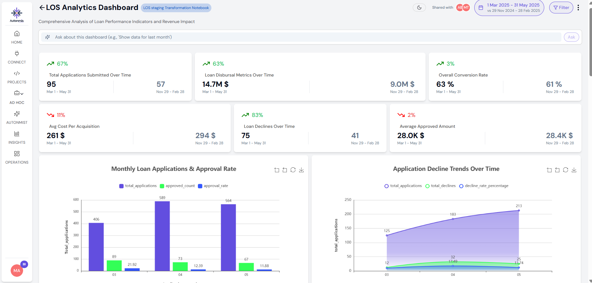
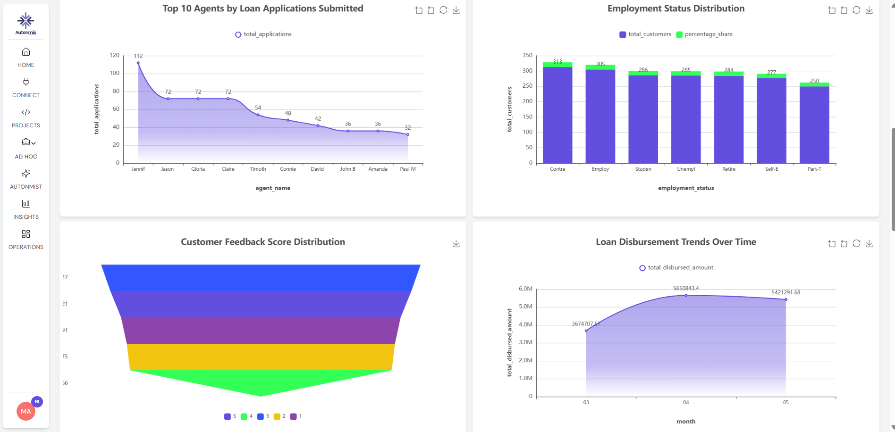
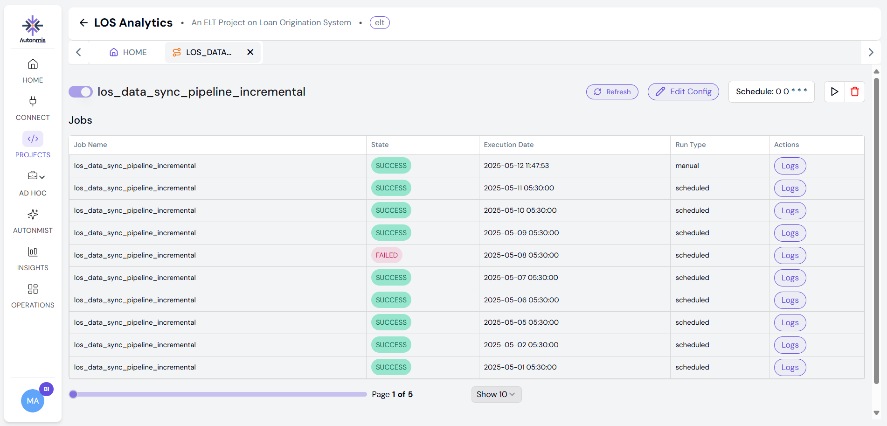
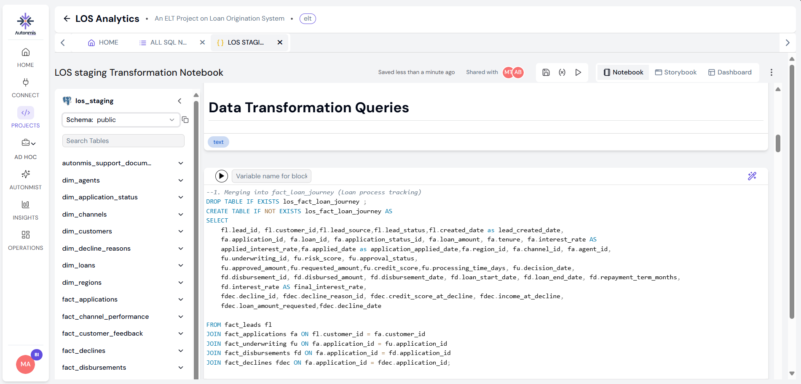

# Loan Origination Analytics (LOS)

My main project from my data analyst internship at **Autonmis** (May 2025): a dashboard that follows a loan from lead to application, underwriting and disbursement. My dashboard is featured in the product video on the autonmis.com home page.

All the data is generated (made up) with Python, so it is safe to share.

## The goal
Leadership wanted to see the whole loan journey in one place: how many leads become applications and approvals, where applications get stuck, why loans are declined, and what each new customer costs.

## What I did
1. **Generated the data in Python** (pandas and Faker): 14 tables, 2,000 rows each.
   - 7 fact tables: leads, applications, underwriting, disbursements, declines, channel performance and customer feedback
   - 7 dimension tables: agents, application status, channels, customers, decline reasons, loans and regions
2. **Built the pipeline:** loaded the tables into PostgreSQL (Neon), then set up an incremental pipeline to Supabase that runs every day and moves only the new rows.
3. **Transformed the data with SQL:** 3 models: a loan-journey table that joins leads, applications, underwriting, disbursements and declines; customer details; and business insights.
4. **Wrote the KPIs in SQL:** average cost per acquisition, applications over time, overall conversion rate, average approved amount, disbursed amounts and declines.
5. **Went deeper:** 12 more queries, for example the approval rate by month, decline reasons, agent performance, credit-score bands and the employment mix.
6. **Built the dashboard and a scheduled report** on the Autonmis platform, with every KPI compared with the previous period.

## Screenshots

| | |
|---|---|
|  |  |
|  |  |

More in [`screenshots/`](screenshots): the KPI notebook, the weekly report and the project brief.

## Tools
Python (pandas, Faker) · PostgreSQL (Neon) · Supabase · SQL · the Autonmis platform (pipelines, notebooks, dashboards, reports)

## Files
- [`docs/write-up.pdf`](docs/write-up.pdf): my 12-page write-up, with the goals, the questions and all the SQL
- [`docs/dashboard-full.pdf`](docs/dashboard-full.pdf): every chart on the dashboard
- [`docs/project-brief.md`](docs/project-brief.md): the brief for the project
- `sql/`: the SQL from the write-up: [transformations](sql/01_transformations.sql), [KPIs](sql/02_kpis.sql) and [analysis](sql/03_analysis.sql)
- `notebooks/`: the Python notebooks that generate the data
- `screenshots/`: the pipeline, the notebooks, the dashboard, the report and the project brief

## What I learned
How a full analytics project fits together: create or collect the data, move it with a pipeline that adds only what's new, model it with SQL, then turn it into KPIs, a dashboard and a scheduled report.

## Looking back: what I would fix today
I kept the SQL as I wrote it in May 2025. Reading it now, I would change three things:

1. **Loan journey table:** it uses inner joins across disbursements and declines, so it only keeps applications that have both. That works only because the data is made up. With real data I would start from applications and use LEFT JOINs.
2. **Loan amount brackets:** the last bracket says "More than 50K", but it catches everything above 35K.
3. **Decline trend:** it groups by disbursement date. A declined loan has no disbursement, so it should use the application date.

---

Part of my **internship at Autonmis** (Dec 2024 – May 2025). [See all my Autonmis repos](https://github.com/manasmehrotra13?tab=repositories&q=Autonmis&sort=name) · [Back to my profile](https://github.com/manasmehrotra13)
